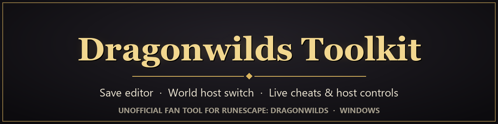
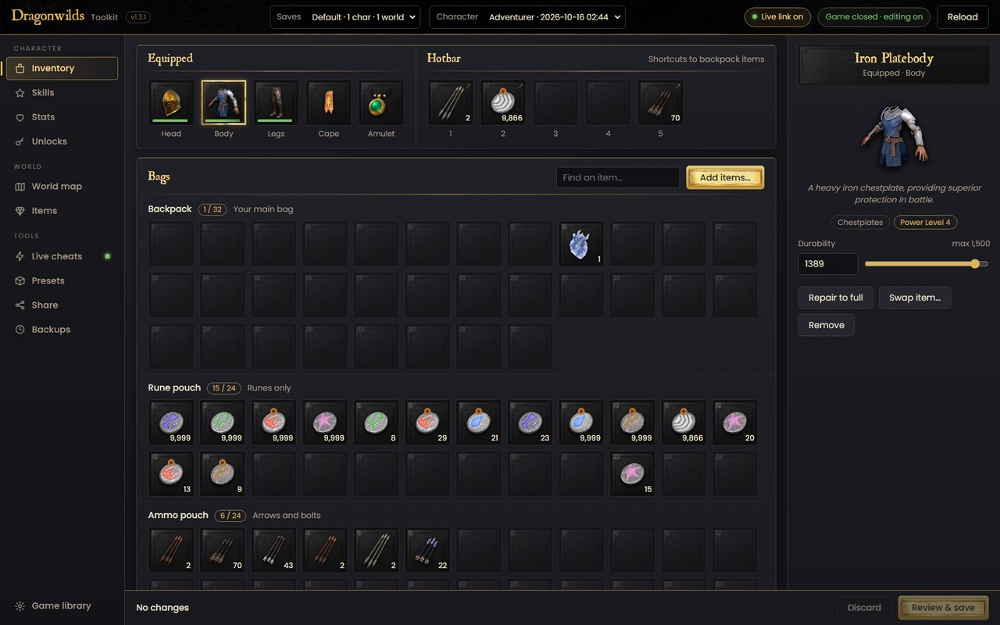
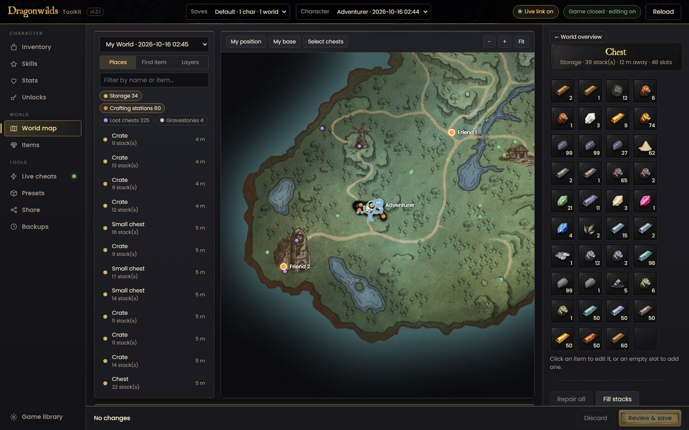
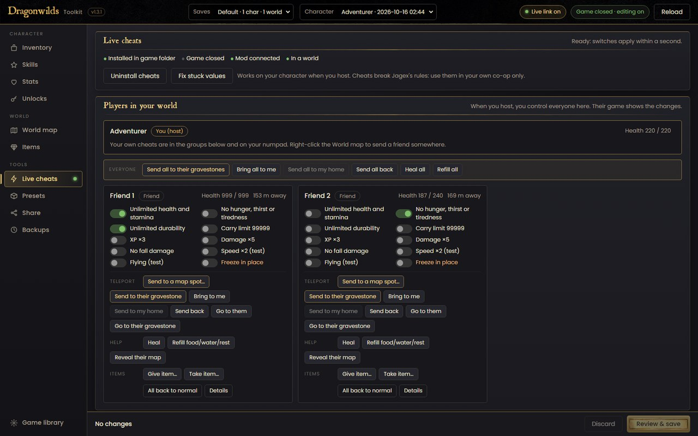
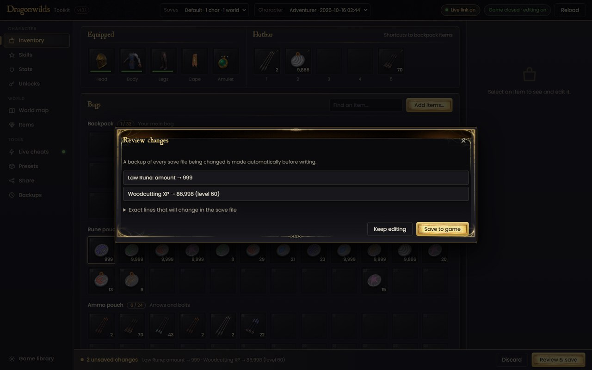
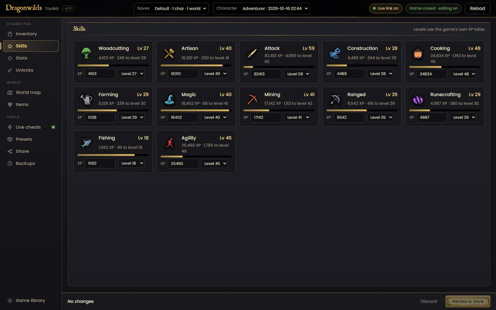
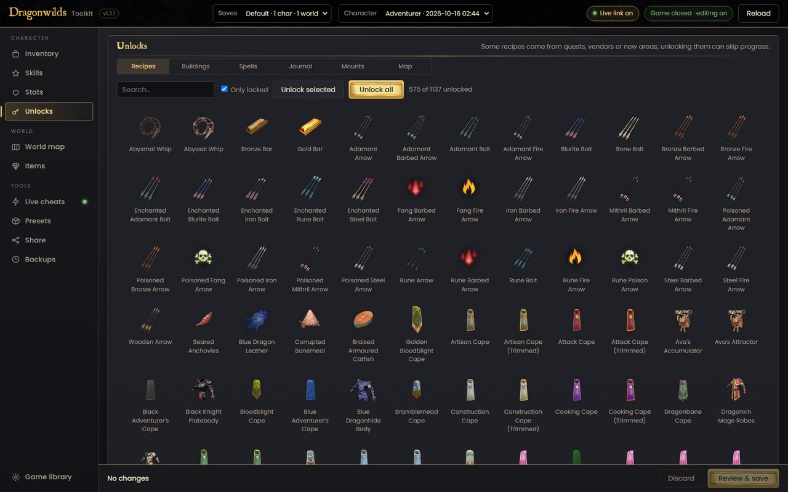

<p align="center">
  
</p>

<p align="center">
  <a href="../../releases/latest"></a>
  <a href="../../releases"></a>
  
  <a href="LICENSE"></a>
</p>

# Dragonwilds Toolkit

**Edit your RuneScape: Dragonwilds saves, move a world to a new host, and use cheats in your own
co-op games. Free, for Windows.**

<p align="center">
  
</p>

> Unofficial fan project, not made or supported by Jagex. RuneScape and Dragonwilds are trademarks of
> Jagex Ltd. No game files are included: the toolkit reads what it needs from your own copy of the game.

---

## Install in 3 steps

1. **Download** the newest `Dragonwilds-Toolkit-vX.Y.Z.zip` from the **[Releases page](../../releases/latest)**.
2. **Unzip it** anywhere (right-click → *Extract All*).
3. **Double-click** `DragonwildsToolkit-vX.Y.Z.exe`.

The first time:
- If Windows shows *"Windows protected your PC"*, click **More info** → **Run anyway**.
  (This appears because the toolkit is new and not paid-signed. It isn't a virus warning.)
- The toolkit finds your game by itself and gets ready in about a minute. If it can't find the game,
  click **Browse** and pick your RuneScape Dragonwilds folder.

That's it. Nothing else to install.

**You need:** Windows 10 or 11, the game installed, and to have played it once (so you have a save).

### Updates
- The toolkit tells you when a new version is out: a gold bar at the top with **What's new** and
  **Download**. Download the new zip, unzip it and use the new exe. Your settings and backups carry over.
  (Turn this off in **Game library** if you like. It only asks GitHub for the latest version number.)
- Want an email too? Click **Watch → Custom → Releases** at the top of this page.

---

## What can I do with it?

| Menu | What it does |
|---|---|
| **Inventory** | Change item amounts and durability, add any item, repair everything |
| **Skills** | Set any skill level |
| **Stats** | Fill food, water, rest and stamina |
| **Unlocks** | Unlock recipes, buildings, spells and map areas |
| **World map** | See and edit every chest in your world, teleport, move gravestones |
| **Share** | Send your world to a friend, or install theirs, to change who hosts |
| **Live cheats** | Cheats while you play: no damage, flying, speed, any item, teleports and more |
| **Backups** | Undo anything: the toolkit backs up your saves automatically |

### Screenshots

| World map: every chest in your world | Live cheats: control your friends when you host |
|---|---|
|  |  |
| **Review before saving: nothing changes until you confirm** | **Skills: set any level** |
|  |  |
| **Unlocks: recipes, buildings, spells, map areas** | |
|  | |

### Editing saves
1. **Quit the game** (editing only works while it's closed).
2. Make your changes. Changed things glow gold.
3. Click **Review & save** at the bottom, check the list, and confirm.
4. Start the game.

A backup is made before every save. Changed your mind? **Backups** → **Restore**.

### Live cheats
1. Quit the game, open **Live cheats** and click **Install cheats** (one time only).
2. Start the game and load your world.
3. Flip switches in the toolkit, or use the **numpad keys** in game:

| Key | Cheat | Key | Cheat |
|---|---|---|---|
| Num 1 | No damage + full stamina | Num 9 | Go to my latest gravestone |
| Num 2 | Carry 99999 | Num . | Go back after a teleport |
| Num 3 | Refill food, water, rest | Num 0 | Everything back to normal |
| Num 4 | Heal | Num + | Flying |
| Num 5 | Tools never break | Num − | Go home |
| Num 6 | No hunger | Num / | Set home here |
| Num 7 | Speed ×2 | Num * | Show/hide the top bar |
| Num 8 | Jump ×3 | | |

Num Lock must be on. **Uninstall cheats** removes everything from the game folder.

### Playing with friends
- **Host a friend's world:** they use **Share → Pack world** and send you the zip; you use
  **Share → Install a world**. Your character stays yours.
- **Control your friends** (when you host): **Live cheats → Players in your world**. Heal them, give
  items, send them to their gravestone or anywhere on the map, give them cheats. Your friends don't
  need to install anything.

---

## Please read

- **Cheats break Jagex's rules.** Use them only in your own private worlds with friends who agree.
- You use this toolkit **at your own risk**. It's careful (backups, review before saving), but keep
  your own copies of anything important.
- After a game update, open **Game library** and click **Build library** if the toolkit asks you to.

**Problems?** Open an [issue](../../issues) and say what you clicked and what happened. The file
`%LOCALAPPDATA%\DragonwildsSaveEditor\errors.log` helps a lot.

---

## For developers

<details>
<summary>Build from source</summary>

Requires Python 3.12+ and Node.js (only used to check the UI scripts).

```bat
python -m venv .venv
.venv\Scripts\python -m pip install -r requirements.txt
.venv\Scripts\python build.py
```

`build.py` checks the UI scripts, downloads the UE4SS release it bundles (checked against a fixed
SHA-256), builds `dist\DragonwildsToolkit-v<version>.exe` and writes a release zip next to the project
folder. The version lives in `dw/version.py`. Run without building: `.venv\Scripts\python app.py`.

| Part | What it does |
|---|---|
| `dw/iostore.py` | Reads the game's IoStore (`.utoc`/`.ucas`) and `.pak` containers |
| `dw/gamedata.py` | Builds the item library (names, icons, stack sizes, XP table) from the user's install |
| `dw/savefile.py` | Character saves, rewritten byte for byte except the changed values |
| `dw/worldsave.py`, `dw/world.py` | World saves: chests, settings, positions, gravestones |
| `dw/cheats.py`, `dw/cheatmod/` | Installs UE4SS and the Lua mod, and talks to it through small text files |
| `ui/` | The interface (HTML/JS), shown with pywebview |

</details>

## Credits

- [UE4SS](https://github.com/UE4SS-RE/RE-UE4SS): the mod loader used for live cheats (MIT licence,
  included in the bundled zip).
- [pywebview](https://github.com/r0x0r/pywebview), [Pillow](https://python-pillow.org/),
  [psutil](https://github.com/giampaolo/psutil), [PyInstaller](https://pyinstaller.org/).
- Extra item stats come from the community
  [xgamingserver Dragonwilds item list](https://xgamingserver.com/tools/dragonwilds/), fetched online.

## Disclaimer

This project is provided as-is, for personal use in your own game worlds. It is not affiliated with or
endorsed by Jagex. You are responsible for following the game's terms of service. The authors accept
no liability for bans, lost progress or any other damage.

## Licence

[MIT](LICENSE) for this project's own code. Game content belongs to Jagex Ltd.
